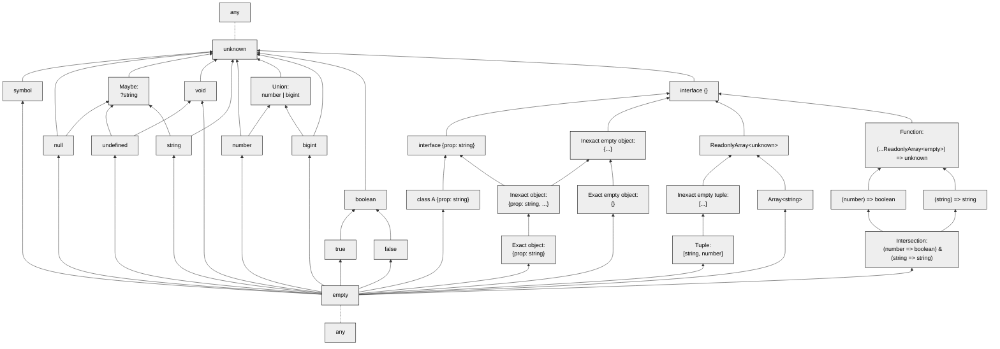

Types in Flow form a hierarchy based on [subtyping](./subtypes.md):

Click on a node to go to the documentation for that type.

Types appearing higher in this graph are more general, while those appearing lower are more specific.
An arrow pointing from type `A` to type `B` means that `A` is a subtype of `B`.
For example, the type `string` is a subtype of `?string`.

How can `any` be at both the top and the bottom? Because [it is unsafe](../types/any.md). This is denoted with a dotted line.

## See Also {#toc-see-also}

- [Subtypes](./subtypes.md) — the theory behind how types relate in the hierarchy
- [Any](../types/any.md) — the unsafe type that is both top and bottom
- [Unknown](../types/unknown.md) — the safe top type (supertype of all types)
- [Empty](../types/empty.md) — the bottom type (subtype of all types)
- [Variance](./variance.md) — how covariance and contravariance affect subtype relationships
